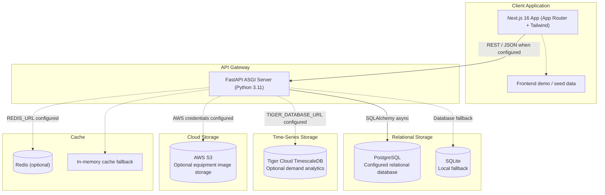

<!-- Saanjha — AI-Powered Community Resource Sharing Platform -->
# Saanjha — AI-Powered Community Resource Sharing Platform

<p align="center">
    
</p>

<p align="center">
    <strong>Share More. Buy Less.</strong>
</p>

<p align="center">
    Built by <strong>Team SAANJA Labs</strong>
</p>

<p align="center">
    <a href="https://nextjs.org"></a>
    <a href="https://fastapi.tiangolo.com/"></a>
    <a href="https://www.postgresql.org/"></a>
    <a href="https://www.timescale.com/"></a>
    <a href="https://groq.com"></a>
</p>

---

Saanjha is a hyperlocal community resource-sharing platform that connects people with underused equipment to people who need it temporarily. It is designed for college students and nearby communities, with a vision to begin on campus and explore nearby communities after validating the product.

**Category:** Smart Solutions, Smarter Society

**Domain:** Agentic AI & Generative AI (AI-backed responses require external configuration)

---

## Project Links & Runtime Notes

| Item | URL or details |
|---|---|
| GitHub repository | [`tejasrastogileet/Saanjha`](https://github.com/tejasrastogileet/Saanjha.git) |
| Local frontend | `http://localhost:3000` |
| Local API docs | `http://localhost:8000/docs` |

No live deployment URL is currently listed. For local development, the frontend can be pointed at the local backend with `NEXT_PUBLIC_API_BASE_URL`.

---

## The Problem Saanjha Addresses

Useful equipment is often needed only occasionally. Students and neighbors may have to buy items they will use briefly, while useful equipment nearby can remain idle. General listings can make it difficult to discover relevant resources, compare practical constraints, and coordinate a borrow with someone new.

Saanjha explores a community-centered alternative:

* **AI-assisted natural-language discovery** for describing what a person needs.
* **Relevant matching** using item/category relevance, location, budget, and availability signals.
* **Trust-oriented workflows** for verification, booking, handover, and return coordination.
* **Local demand analytics** to help identify categories and areas where resources may be needed.
* **Affordable access and reuse** by making it easier to borrow existing equipment temporarily.

---

## Features & Implementation Notes

### 1. AI-Assisted Matching & Distance Scoring
* The frontend matching engine scores item/category relevance, Haversine distance, time overlap, budget fit, and owner trust signals.
* The FastAPI matching endpoint parses natural-language prompts and scores keywords, category, and budget against available resources or a seed catalog. Its current distance and trust scores are placeholders, so its results should not be treated as location-verified recommendations.
* The assistant can call Groq when `GROQ_API_KEY` is configured. Without valid model configuration, AI-backed responses are unavailable; the deterministic matching logic is separate from generative AI.

### 2. Trust, Reviews & Identity Flows
* TrustLens and PeerTrust code provides reputation scoring, reviews, and trust-related UI/API workflows.
* The DigiLocker screen is a simulated demonstration. It does not establish an official DigiLocker, UIDAI, PAN, or academic-registry integration.
* Demo identities and verification states are present. Review authentication and verification behavior before using the project with real users.

### 3. Booking, Handover & Payments
* Booking screens and API routes model booking requests, stage changes, handover/return OTPs, and item-condition steps.
* The current backend booking route uses an in-memory seeded list; booking records are not durable across process restarts.
* Razorpay order, signature, and refund code is present, but demo/mock fallback behavior also exists. This project does not establish a live escrow arrangement or guarantee that a payment or refund is configured or completed. Verify provider configuration and behavior before handling funds.

### 4. DemandPulse Analytics
* Analytics routes accept marketplace events and expose demand summaries, category trends, hourly series, and locality views.
* Tiger Cloud / TimescaleDB is optional and requires a valid `TIGER_DATABASE_URL`. If unavailable or unset, the analytics connector uses a local SQLite fallback; some UI and API responses also contain demonstration data.
* Analytics are intended to help explore local resource needs. They are not validated forecasts or live market measurements without a configured data source.

### 5. Equipment Image Storage
* The FastAPI upload service can use AWS S3 through `boto3` when AWS credentials and bucket settings are configured. The existing default bucket identifier is `reuse-gear-images-2026`.
* If S3 credentials are missing or an upload fails, the backend falls back to local uploads. Public access and durable image URLs depend on the actual bucket policy and deployment configuration.

### 6. Circular Economy & Impact
* The Impact page presents sharing, savings, and environmental indicators to illustrate the intended circular-economy value.
* Displayed impact figures are demo values or estimates, not audited measurements or certified lifecycle-assessment results.

---

## Campus Expansion — Noida & Nearby Communities

These institutions are potential pilot communities or future expansion targets only; they are not confirmed partners, endorsements, or affiliations:

1. KIET Group of Institutions
2. JSS Academy of Technical Education
3. Ajay Kumar Garg Engineering College (AKGEC)
4. GL Bajaj Institute of Technology & Management

Saanjha aims to begin with a campus community and explore expansion to nearby colleges and local communities after validating the platform with real users.

---

## System Architecture & Data Flow

### 1. Resource Discovery & Booking Workflow

```mermaid
sequenceDiagram
    autonumber
    actor B as Borrower
    participant UI as Next.js Frontend
    participant M as Matching Logic
    participant API as FastAPI API
    participant DB as PostgreSQL or SQLite Fallback
    participant P as Razorpay (Optional Configuration)
    actor O as Resource Owner

    B->>UI: Enter natural-language search and filters
    UI->>M: Score candidate resources
    M->>API: Request matching data when using the API
    API->>DB: Read resources or use seed catalog fallback
    M-->>B: Show ranked candidates and match details
    B->>UI: Submit or advance a booking request
    UI->>API: Create booking or advance workflow stage
    API->>API: Current booking route updates in-memory demo data
    O->>B: Coordinate item handover using OTP workflow
    B->>O: Return item and complete return workflow
    opt Razorpay credentials and provider are configured
        API->>P: Create order, verify payment, or request refund
    end
    Note over B,O: Demo screens and seeded data may be used; live payment/refund behavior is not guaranteed.
```

---

### 2. Application Data & Optional Services



---

## Role-Based Access Control (RBAC) & UI Roles

The frontend role switcher exposes four UI personas. These screens demonstrate role-specific navigation; they should not be taken as proof of production-grade authorization across every API route.

| Role | Intended persona | Current UI/API surfaces |
|---|---|---|
| **Borrower** | Person seeking a resource | Explore/search, matching, booking, impact, and review screens |
| **Resource Owner** | Person sharing equipment | Resource listing, dashboard, booking request, and return screens |
| **Delivery Courier** | Person coordinating a delivery | Delivery workflow screens and status actions |
| **Platform Administrator** | Platform operator | Admin and analytics screens; privileged operations require appropriate backend configuration and authorization |

---

## System Stack

```
Saanjha System Stack
├── Frontend: Next.js 16 (App Router), React, TypeScript, Tailwind CSS, Lucide React
├── Backend: Python FastAPI, Uvicorn ASGI Server, Pydantic v2 schemas
├── Relational database: PostgreSQL via SQLAlchemy async / asyncpg; SQLite local fallback
├── Analytics database: Optional Tiger Cloud TimescaleDB; local SQLite fallback
├── Image storage: Optional AWS S3 via Boto3; local upload fallback
├── AI: Optional Groq API for assistant responses; deterministic matching logic also exists
├── Trust: PeerTrust / TrustLens logic and simulated DigiLocker UI
├── Payments: Razorpay API code with demo/mock fallback; live operation is not verified
└── Supporting services: Optional Redis and configured email providers
```

---

## 🗂️ Project Directory Structure

```
reuseproject/
├── .gitignore
├── AGENTS.md
├── ARCHITECTURE.md
├── CLAUDE.md
├── FEASIBILITY.md
├── PRD.md
├── SCALABILITY.md
├── SECURITY.md
├── eslint.config.mjs
├── package.json
├── package-lock.json
├── next.config.ts
├── next-env.d.ts
├── postcss.config.mjs
├── public/
│   └── robots.txt
├── requirements.txt
├── src/
│   ├── app/
│   │   ├── globals.css
│   │   ├── layout.tsx
│   │   ├── page.tsx
│   │   ├── admin/page.tsx
│   │   ├── api/
│   │   │   ├── ai/chat/route.ts
│   │   │   └── upload/route.ts
│   │   ├── bookings/page.tsx
│   │   ├── dashboard/page.tsx
│   │   ├── deliveries/page.tsx
│   │   ├── demandpulse/page.tsx
│   │   ├── explore/page.tsx
│   │   ├── impact/page.tsx
│   │   ├── matches/page.tsx
│   │   ├── needs/page.tsx
│   │   ├── profile/page.tsx
│   │   ├── resource/[id]/page.tsx
│   │   ├── resources/page.tsx
│   │   ├── resources/[id]/page.tsx
│   │   └── reviews/page.tsx
│   ├── components/
│   │   ├── AddResourceModal.tsx
│   │   ├── AIChatDrawer.tsx
│   │   ├── AuthModal.tsx
│   │   ├── BookingModal.tsx
│   │   ├── CategoryGrid.tsx
│   │   ├── ChatDrawer.tsx
│   │   ├── DigiLockerModal.tsx
│   │   ├── FilterSidebar.tsx
│   │   ├── Footer.tsx
│   │   ├── HowItWorks.tsx
│   │   ├── ImpactBar.tsx
│   │   ├── InteractiveMap.tsx
│   │   ├── LifecycleStepper.tsx
│   │   ├── MatchCard.tsx
│   │   ├── Navbar.tsx
│   │   ├── RedisOtpModal.tsx
│   │   ├── RentalAgreementModal.tsx
│   │   ├── ResourceCard.tsx
│   │   ├── ReturnOtpRefundModal.tsx
│   │   ├── SearchBar.tsx
│   │   ├── SystemFallbackBanner.tsx
│   │   ├── TelemetryStrip.tsx
│   │   └── TrustLensPanel.tsx
│   ├── data/mockData.ts
│   └── lib/
│       ├── api.ts
│       ├── matchEngine.ts
│       ├── roleContext.tsx
│       ├── trustEngine.ts
│       ├── types.ts
│       └── utils.ts
├── tsconfig.json
└── backend/
    ├── Dockerfile
    ├── docker-compose.yml
    ├── requirements.txt
    ├── app/
    │   ├── main.py
    │   ├── api/
    │   │   ├── admin.py
    │   │   ├── ai_assistant.py
    │   │   ├── analytics.py
    │   │   ├── auth.py
    │   │   ├── bookings.py
    │   │   ├── chat.py
    │   │   ├── matches.py
    │   │   ├── payments.py
    │   │   ├── resources.py
    │   │   ├── router.py
    │   │   ├── trust.py
    │   │   └── websockets.py
    │   ├── core/
    │   │   ├── config.py
    │   │   ├── database.py
    │   │   ├── email.py
    │   │   ├── redis.py
    │   │   ├── security.py
    │   │   ├── storage.py
    │   │   └── tiger_db.py
    │   ├── models/
    │   │   ├── __init__.py
    │   │   ├── booking.py
    │   │   ├── chat.py
    │   │   ├── dispute.py
    │   │   ├── resource.py
    │   │   ├── review.py
    │   │   └── user.py
    │   ├── schemas/
    │   │   ├── booking.py
    │   │   ├── resource.py
    │   │   ├── trust.py
    │   │   └── user.py
    │   └── services/
    │       ├── __init__.py
    │       ├── demandpulse.py
    │       └── trustlens.py
    ├── tests/
    │   ├── test_demandpulse.py
    │   └── test_trustlens.py
    └── uploads/
```

The Next.js frontend is at the repository root, alongside `package.json`, `src/`, and `public/`. There is no separate frontend directory.

---

## Quick Start & Local Setup

### 1️⃣ Clone Repository
```bash
git clone https://github.com/tejasrastogileet/Saanjha.git
cd reuseproject
```

### 2️⃣ Backend Setup (Python FastAPI)
```bash
cd backend
python -m venv venv
source venv/Scripts/activate
pip install -r requirements.txt
uvicorn app.main:app --reload --port 8000
```

PowerShell activation alternative:

```powershell
cd backend
python -m venv venv
.\venv\Scripts\Activate.ps1
pip install -r requirements.txt
uvicorn app.main:app --reload --port 8000
```

The repository does not currently include `backend/.env.example`. Backend settings are read from `backend/.env`; create it locally only for the services you configure, and do not commit secrets. PostgreSQL is the configured primary database. On startup, the code falls back to SQLite if the PostgreSQL connection fails; this fallback is for local/demo use and does not provide shared production persistence.

Optional settings supported by the current backend include:

* Database/cache: `DATABASE_URL`, `SQLITE_FALLBACK_URL`, `REDIS_URL`
* Demand analytics: `TIGER_DATABASE_URL`
* AWS storage: `AWS_ACCESS_KEY_ID`, `AWS_SECRET_ACCESS_KEY`, `AWS_REGION`, `AWS_S3_BUCKET_NAME`, `S3_BUCKET_NAME`
* AI and payments: `GROQ_API_KEY`, `RAZORPAY_KEY_ID`, `RAZORPAY_KEY_SECRET`
* Email delivery: `BREVO_API_KEY`, `RESEND_API_KEY`, `SENDGRID_API_KEY`, `MAIL_USERNAME`, `MAIL_PASSWORD`

Only configure external services you intend to use. S3, TimescaleDB, Redis, Groq, payment, and email behavior depends on valid credentials and provider-side setup. Local API documentation is at `http://localhost:8000/docs`.

### 3️⃣ Frontend Setup (Next.js 16)
```bash
# From the project root (the directory containing package.json)
npm install
npm run dev
```
Open `http://localhost:3000` in your browser. The frontend uses the configured backend API URL by default; set `NEXT_PUBLIC_API_BASE_URL` locally if you want it to target `http://localhost:8000/api/v1`.

---

## Frontend Build Validation

Run the frontend production build from the repository root:

```bash
npm run build
```

---

## Project Note

Built as a community resource-sharing project focused on access, reuse, and sustainability.

**Share More. Buy Less.**
